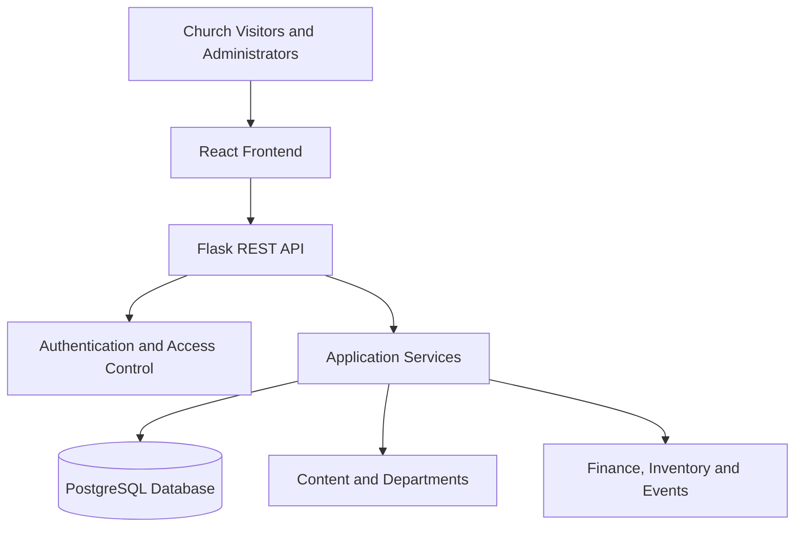
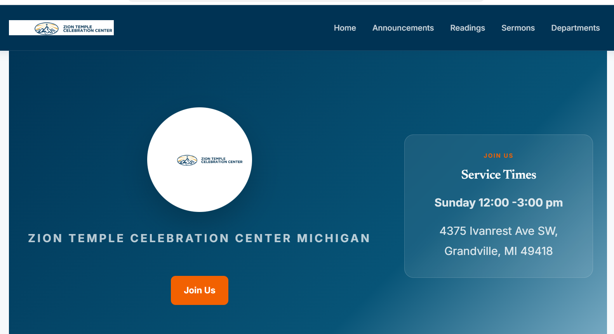

# ChurchOS — Multi-Church Management Platform

ChurchOS is a web-based platform designed to help churches manage their public websites and administrative operations in one place. It combines a public-facing church website with protected administrative features.

**Live Demo:** https://churchos-web.onrender.com

**Public Showcase Repository:** https://github.com/tuyishimejeanpierre-byte/churchos-showcase

## Project Overview

ChurchOS is designed around a multi-church structure, with role-based access to administrative features. Its goal is to provide a practical foundation for organizing church content, departments, finances, inventory, and events.

## Key Features

- **Public Website:** Present church information, announcements, readings, and sermons.
- **Authentication and Authorization:** Protect administrative features using authenticated access and user roles.
- **Department Management:** Organize church departments and their activities.
- **Financial Management:** Support financial records and reporting.
- **Inventory Management:** Organize inventory-related records.
- **Event Management:** Support church event administration.
- **Administrative Dashboard:** Provide access to management features according to user roles.

## Technology Stack

| Layer | Technologies |
|---|---|
| Frontend | React, JavaScript, Vite |
| UI and Styling | Tailwind CSS, Bootstrap |
| Backend | Python, Flask, REST APIs |
| Database | PostgreSQL, SQLAlchemy |
| Authentication | JSON Web Tokens (JWT) |
| Database Migrations | Flask-Migrate |
| Deployment | Render |

## System Architecture

The application follows a client-server architecture.

## My Role

I work across the frontend and backend, developing application features and integrating the components that support the platform.

My work includes:

- Building user interfaces with React.
- Developing backend functionality and REST API endpoints with Flask.
- Integrating database models and application data using SQLAlchemy and PostgreSQL.
- Implementing authentication and role-based access.
- Developing administrative features for content, departments, finance, inventory, and events.
- Improving usability, application structure, and responsive layouts.

## Project Screenshot

### Public Website

## Security and Source Code

This repository is a public project showcase containing documentation, an architecture diagram, and an approved screenshot. The application source code is maintained separately in a private repository.

No credentials, private keys, or environment configuration files should be published in this showcase.

## Project Status

ChurchOS has a deployed demonstration and continues to evolve as features are developed, tested, and improved.

## Contact

**Developer:** Tuyishime Jean-Pierre

**GitHub:** [tuyishimejeanpierre-byte](https://github.com/tuyishimejeanpierre-byte)

---

Built as a practical software engineering project focused on church administration and web application development.
