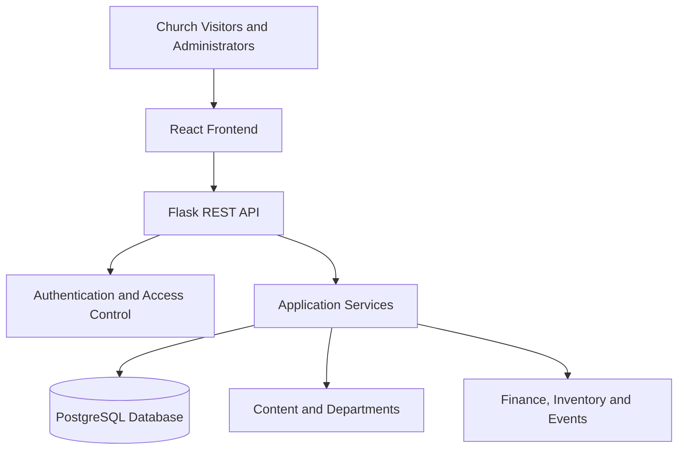

# ChurchOS

A multi-church management platform built with React, Flask, and PostgreSQL.

## Live Demo

[Open the live ChurchOS website](https://churchos-web.onrender.com)

## Features

- Public church website
- Authentication and role-based access
- Department management
- Financial management and reporting
- Inventory and event management

## Technology Stack

- Frontend: React, JavaScript, Vite
- Styling: Tailwind CSS, Bootstrap
- Backend: Python, Flask
- Database: PostgreSQL, SQLAlchemy
- Authentication: JWT
- Migrations: Flask-Migrate

## Architecture

Visitors -> React frontend -> Flask API -> PostgreSQL database

## Security

The application source code remains in a separate private repository. This repository contains public project documentation only.

## My Role

I develop the frontend, backend APIs, database integration, authentication, and administrative features.

## Screenshots

### Public Website

## Architecture Diagram

The following diagram shows the high-level structure of ChurchOS.

